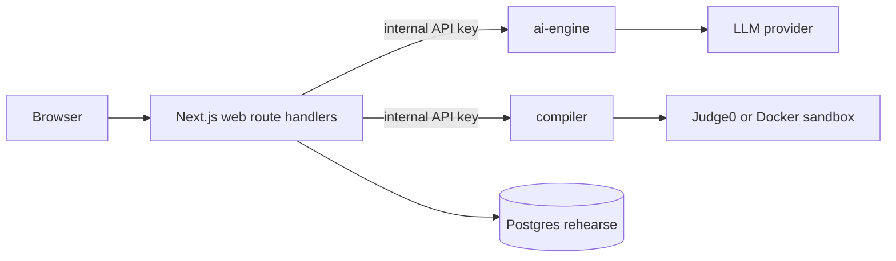

# rehearse

Practice the interview you'll actually get.

Rehearse is an AI-powered mock interview platform: resume and job-description based simulation, skill-gap analysis, timed interviews, and an in-browser compiler.

## Status

Phase 0 scaffold is in place. Feature work starts with Phase 1. See [docs/PLAN.md](docs/PLAN.md) for architecture, API contracts, schema, and phases.

When a phase prompt is sent, that prompt's scope overrides the plan file.

## Setup

```bash
pnpm install
cp .env.example .env
pnpm dev
```

Web: http://localhost:3000  
AI engine health: http://localhost:4001/health  
Compiler health: http://localhost:4002/health

Postgres (optional locally):

```bash
docker compose up rehearse-postgres
```

## Scripts

| Command | Purpose |
| --- | --- |
| `pnpm dev` | Run web + services |
| `pnpm build` | Production build |
| `pnpm db:migrate` | Prisma migrate (Phase 1) |
| `pnpm db:seed` | Seed (Phase 1) |
| `docker compose up` | Full stack |

## Environment

Copy `.env.example`. Switch LLM with `LLM_PROVIDER=gemini|anthropic|openai`. Switch sandbox with `SANDBOX_DRIVER=judge0|docker`. Keep `INTERNAL_API_KEY` and `DATA_ENCRYPTION_KEY` out of the browser.

Production should terminate TLS at the edge; resume and JD text are encrypted at rest with AES-256-GCM.

## Architecture


