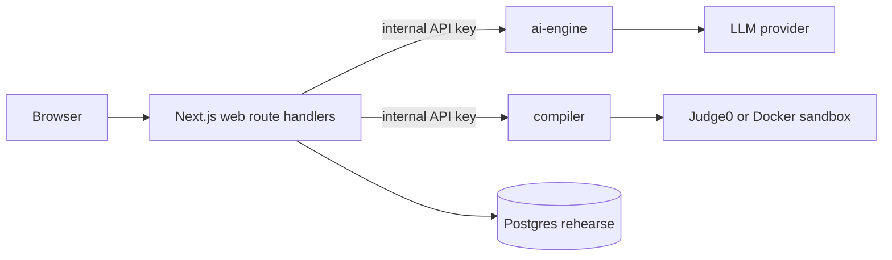

# Rehearse — implementation plan

**Tagline:** Practice the interview you'll actually get.

This document is the written plan for the monorepo. Scaffolding (Phase 0) creates the repo skeleton only. Product features ship in Phases 1–5 when those prompts are sent.

**Phase prompt override:** when a phase prompt is sent, **that prompt's scope overrides anything else in this file**. Implement only what the phase prompt asks; do not pull forward later-phase work unless the phase prompt includes it.

Default LLM in env examples: **Google Gemini** (`LLM_PROVIDER=gemini`). Anthropic Claude and OpenAI remain supported via the same `LLMProvider` interface.

---

## Folder structure

```
/
  apps/web/                      @rehearse/web     Next.js App Router
    app/
    components/
    lib/
    public/
    prisma/                      schema only until Phase 1 migrate
  services/ai-engine/            @rehearse/ai-engine
  services/compiler/             @rehearse/compiler
  packages/shared/               @rehearse/shared   Zod schemas + TS types
  docker-compose.yml
  turbo.json
  pnpm-workspace.yaml
  docs/PLAN.md
  README.md
```

Docker service names: `rehearse-web`, `rehearse-ai-engine`, `rehearse-compiler`, `rehearse-postgres`. Database name: `rehearse`.

---

## Package list

| Package | Role |
| --- | --- |
| `@rehearse/web` | Next.js, Tailwind, shadcn, next-themes, Auth.js (Phase 1) |
| `@rehearse/ai-engine` | Fastify AI service |
| `@rehearse/compiler` | Fastify sandbox service |
| `@rehearse/shared` | Zod + shared types |
| root | Turborepo scripts: `dev`, `build`, `lint`, `db:migrate`, `db:seed` |

---

## Architecture

The browser talks only to Next.js. Server route handlers call ai-engine and compiler with `INTERNAL_API_KEY`, persist to Postgres, and never expose service URLs or LLM keys to the client. The compiler uses Judge0 or a local Docker sandbox (`SANDBOX_DRIVER`). The ai-engine calls the selected LLM (`LLM_PROVIDER`, default Gemini). Assume TLS in production.



---

## API contract

Web **never** calls services from the browser. Next.js route handlers proxy with header `x-internal-key` / `INTERNAL_API_KEY`. All JSON errors: `{ error: { code, message } }`.

### ai-engine

| Method | Endpoint | Request | Response |
| --- | --- | --- | --- |
| GET | `/health` | — | `{ status, service }` |
| POST | `/v1/parse/resume` | `{ fileBase64?, text?, mime }` | `{ parsed: ResumeParsed }` |
| POST | `/v1/parse/jd` | `{ text }` | `{ parsed: JdParsed }` |
| POST | `/v1/skill-gap` | `{ resume, jd }` | `{ matched, missing, partial, matchScore, narrative }` |
| POST | `/v1/questions/generate` | `{ skillGap, config, bankHints }` | `{ questions[] }` |
| POST | `/v1/evaluate/answer` | `{ questionSnapshot, answer, type }` | `{ score, subscores, feedback, outline, estimated? }` |
| POST | `/v1/evaluate/code` | `{ source, language, testsSummary, rubric }` | `{ review, score }` |
| POST | `/v1/feedback/report` | `{ sessionPayload }` | `{ report }` |
| POST | `/v1/admin/draft-question` | `{ prompt, type }` | draft question JSON |

### compiler

| Method | Endpoint | Request | Response |
| --- | --- | --- | --- |
| GET | `/health` | — | `{ status, service }` |
| POST | `/v1/execute` | `{ language, source, stdin?, tests?, limits }` | `{ status, stdout, stderr, timeMs, memoryKb, compileError, tests[] }` |

### web (App Router)

Auth, resume/JD CRUD, sessions, code run/submit, reports, admin CRUD, analytics. Rate-limit auth, `/api/code/*`, `/api/ai/*`.

---

## Data model (Prisma)

Models: `User`, `Resume`, `JobDescription`, `InterviewSession`, `Question` (soft-delete), `SessionQuestion`, `CodeSubmission`, `FeedbackReport`, `AuditLog`.

- Encrypt resume/JD `encryptedText` with AES-256-GCM (`DATA_ENCRYPTION_KEY`).
- Indexes: `User.email`, `InterviewSession.userId` + `status`, `Question.type` + `difficulty`.
- Cascades: user delete → resumes, JDs, sessions; session delete → session questions, submissions, report.

**Seed**

- Phase 1: admin (from env), demo candidate, 200+ skills taxonomy JSON.
- Phase 2: question-bank seed (40+ including 10+ coding) for blending/fallback.

---

## Design system

Palette (CSS variables only): dark default `#000000` / surface `#0A0A0A` / elevated `#111111` / border `#1F1F1F` / muted `#8A8A8A` / text `#EDEDED`; light inverse. `next-themes` system/dark/light. Geist Sans + Geist Mono. No chromatic hues. `<Logo />`: lowercase “rehearse” plus blinking square. Monochrome Monaco theme in Phase 4.

---

## Phase breakdown

Phase 0 (this scaffold): `docs/PLAN.md` + monorepo + design tokens + base layout + `/health` services + boot check. Do not start Phases 1–5 until a phase prompt is sent.

- **Phase 1:** Prisma migrate + seed (admin, demo candidate, 200+ skills taxonomy), Auth.js credentials + roles, app shell + command palette, full landing page, ai-engine resume/JD parsing + skill-gap, onboarding flow (upload, review chips, skill gap), dashboard skeleton, encryption.
- **Phase 2:** AI question generation (conceptual, behavioural, coding with test cases + reference solutions), question bank blending + fallback, interview config page.
- **Phase 3:** Interview simulation (timers, autosave, voice input, TTS, integrity nudges, session lifecycle, resume in progress).
- **Phase 4:** Compiler service (Judge0 + Docker drivers), Monaco editor split view, run vs submit, hidden tests, submission persistence.
- **Phase 5:** AI evaluation, scoring aggregation, feedback report + PDF export + share link, candidate analytics, admin question bank CRUD/import/AI draft, admin analytics, settings, hardening, tests, Playwright e2e.
