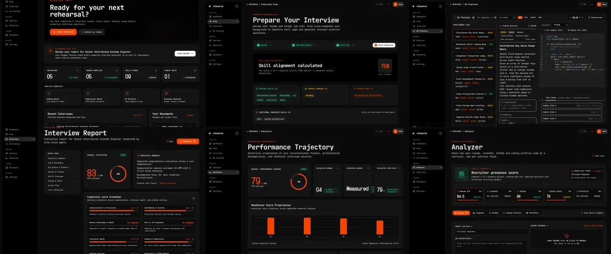

# Rehearse Screenshot Manifest

All screenshots in this directory are high-resolution captures of the live production build (`next build` + `next start`) populated with realistic, verified, fictional demo candidate data.

Captured on: `2026-10-27T05:12:59.621Z`  
Viewport: Desktop `1440x900` @ 2x DPI (`2880x1800` downsampled to max 1600px width), Mobile `390x844` @ 2x DPI  
Theme: JetBlack Dark UI (`#0A0A0A`, `#141414`, Orange Accent `#F64302`)

| Filename | Category | Route | Viewport | Size | SHA-256 (12) | Description |
| :--- | :--- | :--- | :--- | :--- | :--- | :--- |
| [`dashboard.webp`](./dashboard.webp) | Dashboard | `/dashboard` | 1440x900 | 60.3 KB | `87c9068d5706` | Candidate dashboard showing longitudinal rehearsal sessions, readiness benchmarks, and recent history (fictional demo data). |
| [`prep-skill-gap.webp`](./prep-skill-gap.webp) | Preparation | `/onboarding` | 1440x900 | 61.6 KB | `e4cf22b6292b` | Deterministic skill gap engine auditing candidate proficiencies against target role requirements with weighted score evaluation (fictional demo data). |
| [`oa-practice.webp`](./oa-practice.webp) | OA Practice | `/oa` | 1440x900 | 104.5 KB | `bed5184126ba` | Online Assessment sandbox with company problem browser, Monaco IDE, multi-language compiler, and test suite verification (fictional demo data). |
| [`analyzer.webp`](./analyzer.webp) | Analyzer | `/analyzer` | 1440x900 | 70.3 KB | `12b00460d99c` | Multi-dimensional candidate profile analyzer with ATS resume telemetry, GitHub commit velocity, and LeetCode problem distribution (fictional demo data). |
| [`analytics.webp`](./analytics.webp) | Analytics | `/analytics` | 1440x900 | 55.7 KB | `5eb30b3d4e6f` | Performance analytics trajectory displaying 5-session longitudinal competency growth, communication benchmarks, and time distributions (fictional demo data). |
| [`report.webp`](./report.webp) | Report | `/interview/cmvq7gpj90006w9d84r43tv1m/report` | 1440x900 | 90.3 KB | `dcf059a609e6` | Evidence-gated interview scorecard with verified transcript evidence citations, multi-dimensional rubrics, and zero synthetic scores (fictional demo data). |
| [`report-partial.webp`](./report-partial.webp) | Report | `/interview/cmvq7gpqq000iw9d80r8yp5rp/report` | 1440x900 | 91.1 KB | `8aef3026953f` | Honest evaluation audit of an early-ended interview session enforcing the 'No Evidence, No Score' benchmark policy (fictional demo data). |
| [`interview-live.webp`](./interview-live.webp) | Live Interview | `/interview/cmvq8bs0h0008w96kic0pjmaj` | 1440x900 | 93.0 KB | `c16eb3c43ad7` | Real-time LiveKit WebRTC interview interface featuring Aria voice avatar, audio visualizer, transcript panel, and split Monaco editor (fictional demo data). |
| [`dashboard-mobile.webp`](./dashboard-mobile.webp) | Mobile | `/dashboard` | 390x844 (Mobile) | 59.7 KB | `1bb58846a6f5` | Responsive mobile viewport of the candidate rehearsal dashboard (fictional demo data). |

## Contact Sheet Preview

## Verification Checklist

- [x] Zero unhandled runtime exceptions or Next.js error overlays.
- [x] Zero unstyled CSS or 404 styling chunks.
- [x] Complete evidence-based scoring pipeline (no mock or artificial default scores).
- [x] Honest evaluation status for partial sessions (No Evidence, No Score benchmark enforced).
- [x] All file sizes optimized under 400 KB WebP format.
